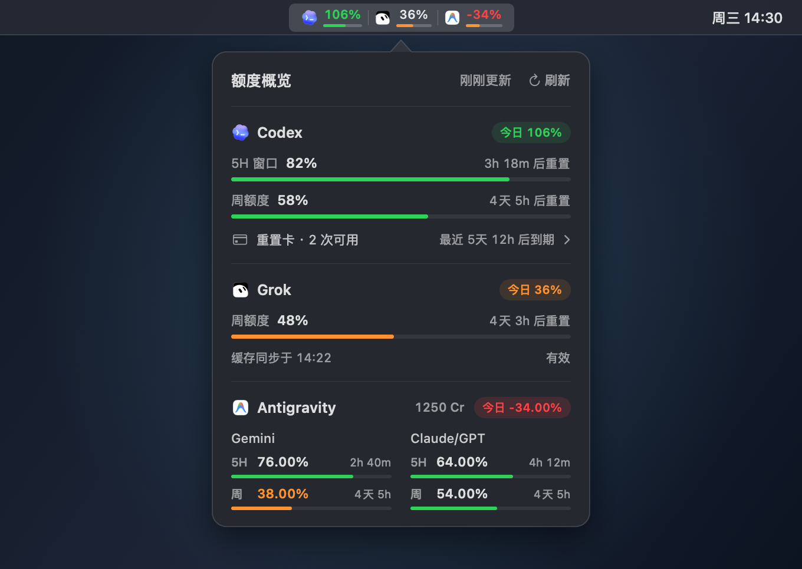

# macOS AI 额度菜单栏（QuotaBar）

在 macOS 顶部菜单栏实时查看 **Codex**、**Grok Bot** 和 **Antigravity CLI (`agy`)** 的今日可用预算、周剩余额度与重置倒计时。

原生 Swift + AppKit / SwiftUI 构建，常驻内存极低，只显示本机已安装的工具，**不读取任何登录 Token、Cookie 或 Keychain 凭据**。

<!-- 建议后续截一张「顶部菜单栏 + 展开卡片面板」的高清图放至 Assets/preview.png 并取消下行注释：

-->

## 为什么做这个工具

同时重度使用多个 AI 编程工具时，最烦的是写代码写到一半突然撞到 5 小时或周额度上限，或者每次都要切回桌面客户端 / 终端查用量。

`QuotaBar` 直接常驻在 macOS 顶部菜单栏：

- **一眼看清还能用多少**：按周额度折算「今日可用预算 `D`」（支持前几天结转、超用标红为负数），配合周剩余 `W` 进度条，每天心里有数。
- **按需自动发现**：自动检测本机安装了 Codex、Grok Bot 还是 Antigravity CLI，只展示已安装的应用；单个工具超时或失败不影响其他工具。
- **两种顶栏样式 + 原生卡片面板**：左键展开 `320pt` 原生 `NSPopover` 面板看各模型池详情、倒计时与 Codex 重置卡；右键切换顶栏显示样式或立即刷新。
- **本地只读、不碰凭据**：Codex 走官方本地 `app-server`，Antigravity 走官方无头命令 `agy -p /usage`，Grok Bot 只读本地缓存文件，绝不触碰账号密码或浏览器 Session。

## 从源码构建并运行

### 环境要求

- macOS 13 或更新版本
- Swift 5.9 或更新工具链（安装 Xcode 或 Xcode Command Line Tools 即可：`xcode-select --install`）
- 本机安装并登录 Codex、Grok Bot 或 Antigravity CLI (`agy`) 中的任意一个或多个
- 查看 Grok Bot 额度前，需至少在 Grok Bot 中打开过一次用量菜单以生成本地缓存

### 构建运行

```bash
git clone https://github.com/hcmango/macos-quota-menubar.git
cd macos-quota-menubar
./script/build_and_run.sh
```

脚本会构建 `dist/QuotaBar.app` 并直接启动。如需长期安装到本机：

1. 在菜单栏右键退出当前运行中的版本；
2. 将完整的 `dist/QuotaBar.app` 复制到 `/Applications` 并打开（应用包内含图标资源，请勿只拷贝内部可执行文件）。

## 界面与额度说明

### 顶部菜单栏样式

右键点击状态栏图标可在两种样式间切换（自动保存偏好）：

- **进度条（默认）**：各应用图标右侧上方显示主数值（有周额度时显示今日剩余预算 `D`，仅含 5 小时或试用窗口时显示该窗口余量），下方以 `2.5px` 微型进度条反映周剩余额度 `W`。
- **双行极简**：`D` / `W` 双行等宽百分比，无胶囊边框，视觉更通透。

菜单栏默认文字与进度条轨道采用 macOS 原生模板图，自动适配深浅色壁纸与系统外观。

### 下拉卡片面板与颜色规则

左键点击图标展开原生 `NSPopover` 卡片面板，支持顶部手动刷新、点击外部区域或按 `Esc` 收起：

| 指标 / 区域 | 含义 | 颜色规则 |
| :--- | :--- | :--- |
| **今日预算 `D`** | 截至今日的累计剩余预算（含前几天结转） | `> 50%` 绿色，`20%～50%` 琥珀橙（顶栏文字保持系统前景色），`< 20%` 或为负标红 |
| **窗口余量 / `W` / `5H`** | 剩余额度百分比与进度条 | `> 50%` 绿色，`21%～50%` 琥珀橙，`≤ 20%` 标红 |
| **Codex 重置卡** | 默认折叠为单行摘要，显示可用次数与最近到期倒计时；点击平滑展开明细 | 距到期不足 72 小时标红 |
| **Grok Bot** | 周额度或试用额度、同步时间与缓存状态 | 试用额度不计算日预算；余量 `≤ 20%` 标红 |
| **Antigravity (`agy`)** | Gemini 与 Claude / GPT 双池并排展示 `5H` 与周额度，头部显示 `AI Credits` 余额 | 按各池余量独立着色 |

倒计时统一精简为 `2天 5h` / `17h 05m` / `42m`（省略 `0天` 前缀）。

### 今日预算 `D` 算法

每份日预算等于周总额度的 `1/7`。以周重置时间减去 7 天作为本周起点：重置当天分配第 1 份，此后按本机时区每过一次零点增加 1 份，一周最多 7 份。减去本周已用额度后，得到截至今天的累计剩余预算：

设截至今日已分配 `k` 份日预算，本周已用百分比为 `u`，则：

```text
D = round(100 × k − 7 × min(u, 100))%
```

- **正常结转**：已分配 3 天预算、本周已用 30% 时，`D = 300 − 210 = 90%`，`W = 70%`。`D` 的 `100%` 代表 1 份日预算；前几天省下的额度会结转，因此 `D` 可以超过 `100%`（例如已分配 2 天且仅用 10%，显示 `D 130%`）。
- **超用提醒**：超出截至今天的累计预算时，`D` 显示负数并标红（例如已分配 3 天、已用 50%，显示 `D -50%`、`W 50%`，表示超用了半份日预算）。
- **降级规则**：缺少周用量或重置时间、或已到达重置时间时显示 `--`；Grok 试用额度不参与日预算计算。

## 数据来源与刷新机制

### Codex

- 通过本地 `codex app-server` 的 `account/rateLimits/read` 读取 5 小时/周额度与可用重置卡。
- 自动通过 bundle id `com.openai.codex` 查找 Codex Desktop，或依次检测 `/opt/homebrew/bin/codex`、`/usr/local/bin/codex`。
- 启动初始化超时 15 秒、额度查询超时 30 秒，超时后自动重试一次；失败时在面板显示对应阶段。

### Grok Bot

- 适配 Grok Bot `0.79.2`（schema 2）与 `1.1.0`（schema 3）的本地 `weekly-usage.cache`，仅读取以下路径以确认当前登录账号与缓存：
  - `~/Library/Application Support/Grok Bot/sand-client-persistence`
  - `~/Library/Application Support/Grok Bot/desktop-status.json`
- 不读取登录令牌、Cookie 或浏览器 Session，也不主动请求 Grok 服务端。需要最新数据时，在 Grok Bot 中打开一次用量菜单再点击刷新即可。
- 缓存到达自身过期时间、距上次查询满 24 小时或到达重置时间（三者取最早）时失效并提示。

### Antigravity CLI (`agy`)

- 通过官方无头斜杠命令 `agy -p /usage --output-format json` 与 `agy -p /credits --output-format json` 获取各模型池额度与 `AI Credits`（不触发对话、不读取本地凭据，登录状态由 `agy` 自身维护）。
- 顶栏展示主池（Gemini）的 `D` / `W`，下拉面板完整展示 Gemini 与 Claude / GPT 双池的 `5H`、周额度、重置倒计时与 `AI Credits`。
- 自动查找 `~/.local/bin/agy`、`/opt/homebrew/bin/agy`、`/usr/local/bin/agy` 及 `PATH` 中的 `agy`；检测到未登录时立即中止并给出登录指引。

### 自动刷新与隔离

- 后台每轮拉取完成后等待 3 分钟自动刷新；卡片展开期间每 30 秒刷新倒计时与相对更新时间，也可随时手动刷新。
- 三个数据源相互独立，互不阻塞；未安装任何支持的工具时自动隐藏状态栏项。

## 开发、测试与打包

```bash
swift test
swift build -c release
./script/build_and_run.sh --verify
```

`--verify` 会启动 `dist/QuotaBar.app` 并验证进程存活。单元测试覆盖窗口映射、app-server 通信、Grok 缓存与账号隔离、`agy` 解析、安装检测、独立刷新、日预算结转、颜色阈值与偏好持久化。

构建本机自用 DMG（ad-hoc 签名）：

```bash
./script/package_dmg.sh
```

脚本将生成 `dist/QuotaBar-1.0.0.dmg`。面向其他用户公开发布安装包前的 Apple Developer ID 签名与公证步骤见 [RELEASE.md](RELEASE.md)。

## 资源与商标说明

- App 图标位于 `Assets/`；状态栏应用标识位于 `Sources/QuotaBar/Resources/`，分别对应 Codex、Grok Bot 与 Antigravity，相关品牌与商标归各自权利人所有。
- Codex 本地 `app-server` 协议、Grok Bot 本地缓存结构或 `agy` 输出格式可能随官方更新变动，欢迎提交 Issue / PR 适配。
- 若 Codex 安装在非标准路径且 Launch Services 无法定位，可调整 `Sources/QuotaBar/Services/CodexAppServerClient.swift` 中的 `codexExecutableURL()`。

## 关于作者

我是 **硬核芒果派（hcmango）**，5 年后端开发、前技术负责人，目前在用 AI 做全栈独立开发，持续开源自己在用的小工具与工程规范：

- GitHub：[github.com/hcmango](https://github.com/hcmango)
- B 站：[硬核芒果派](https://space.bilibili.com/24226360)
- X / Twitter：[@hardcoreMG](https://x.com/hardcoreMG)
- 微信公众号：搜「硬核芒果派」

觉得有用欢迎点个 Star，有新工具适配建议或 Bug 直接提 [Issue](https://github.com/hcmango/macos-quota-menubar/issues)。

## 开源协议

采用 MIT License 开源，详见 [LICENSE](LICENSE)。
